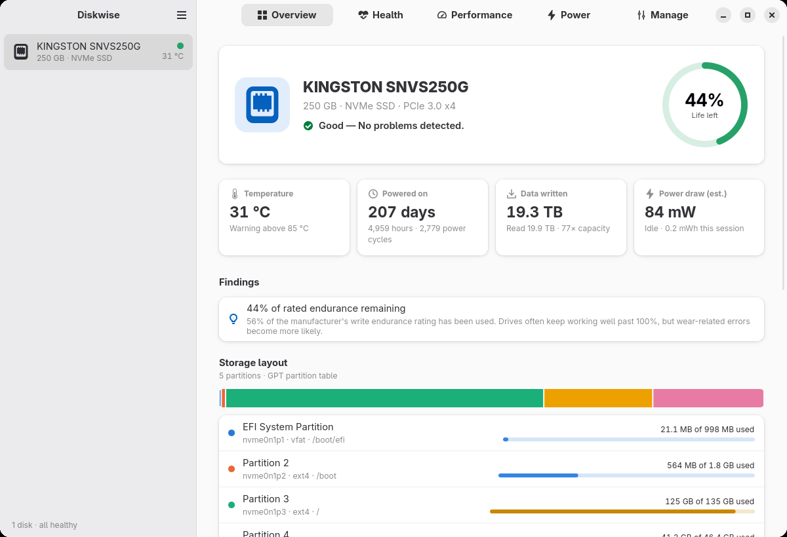
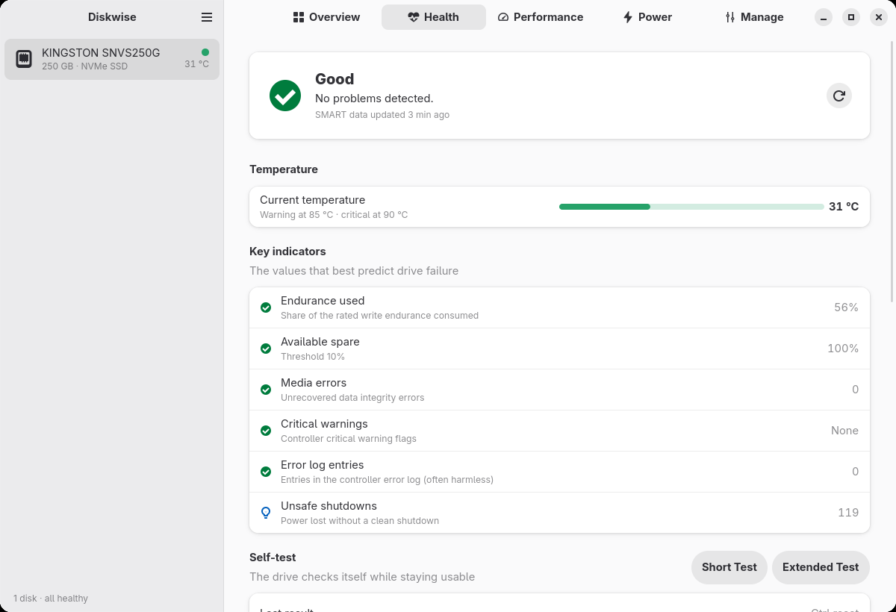

<p align="center">
  
</p>

<h1 align="center">Diskwise</h1>

<p align="center"><strong>Know your drives.</strong><br>
Health, speed, power use and safe management for every drive, in one GNOME app.</p>

<p align="center">
  
  
  
</p>



## Why Diskwise?

Drive health data is hidden behind cryptic SMART attribute tables and command-line tools, and the
tools that format disks rarely stop you from wiping the wrong one. Diskwise turns raw SMART and NVMe
health data into a plain-language verdict, shows how fast and how hot each drive runs, estimates its
power draw, and wraps every destructive operation in safeguards that protect the disk your system
runs from.

## Features

| Page | What it shows and does |
|---|---|
| **Overview** | Health score and plain-language verdict, temperature, power-on time, data written, estimated power draw, findings, partition map with usage, device details |
| **Health** | Status, temperature against the drive's limits, key failure indicators, self-tests (short, extended, abort), full SMART attribute table or NVMe health log |
| **Performance** | Live read/write chart, IOPS, busy %, latency. Speed tests: read and write on a temporary file, and a read-only surface scan of the whole disk |
| **Power** | Power state, estimated draw, session and lifetime energy, power profile, NVMe power states, APM / ALPM / APST settings, share of battery draw |
| **Manage** | Mount and unmount, unlock and lock encrypted volumes, rename, check and repair filesystems, create, format and delete partitions, format the whole disk (GPT or MBR; ext4, Btrfs, XFS, exFAT, NTFS or FAT32; optional LUKS encryption and zero fill), power off, eject, spin down, and persistent standby / APM / write-cache settings |

Works with NVMe, SATA SSDs, hard disks and USB drives. The layout adapts down to phone-sized windows.



### Safety

- The disk holding the running system (`/`, `/boot`, `/boot/efi`, `/home`, `/usr`, `/var` or active
  swap, including through LUKS or LVM) cannot be formatted. Its system partitions cannot be
  formatted, deleted, unmounted or locked. Other partitions on that disk stay manageable.
- Every destructive action lists what will be lost and requires typing the device name (for example `sda`).
- Filesystems are unmounted and encrypted volumes locked before formatting.
- All operations go through UDisks2, so polkit asks for your password wherever the system requires it.

## Requirements

- Linux with a graphical desktop (developed and tested on Fedora 44)
- Python 3 with PyGObject
- GTK 4 and **libadwaita 1.6 or newer** (Fedora 41+, Ubuntu 24.10+, Debian 13+)
- UDisks2 (the standard disk service on GNOME and most desktops)
- `smartmontools` and `nvme-cli` for the privileged power-state queries
- Optional filesystem tools for formatting: `exfatprogs`, `ntfsprogs`, `dosfstools`, `xfsprogs`,
  `btrfs-progs`, `cryptsetup`

## Installation

### 1. Install the system packages (Fedora)

```bash
sudo dnf install python3-gobject gtk4 libadwaita udisks2 smartmontools nvme-cli
# Optional, for formatting with these filesystems and encryption
sudo dnf install exfatprogs ntfsprogs dosfstools xfsprogs btrfs-progs cryptsetup
```

On other distributions, install the equivalent packages.

### 2. Get Diskwise

```bash
git clone https://github.com/peteriishak/Diskwise.git
cd Diskwise
```

### 3. Run or install

**Run from the source tree (no installation):**

```bash
./diskwise-run
```

**Install with the included script:**

```bash
./install.sh                 # current user (~/.local); appears in the app grid
sudo ./install.sh /usr       # system-wide; also installs the privileged helper and its polkit policy
./install.sh --uninstall     # remove a user install (add /usr for a system-wide one)
```

The installer checks for missing packages and prints the `dnf` command to install them. Make sure
`~/.local/bin` is on your `PATH` to start a user install from a terminal with `diskwise`.

**Or build an RPM (Fedora):**

```bash
sudo dnf install rpm-build desktop-file-utils libappstream-glib
mkdir -p ~/rpmbuild/SOURCES
git archive --prefix=Diskwise-1.0.0/ -o ~/rpmbuild/SOURCES/diskwise-1.0.0.tar.gz HEAD
rpmbuild -ba diskwise.spec
sudo dnf install ~/rpmbuild/RPMS/noarch/diskwise-1.0.0-*.rpm
```

## Usage

Start **Diskwise** from the app grid (or run `diskwise`). Pick a drive in the sidebar, then switch
between the **Overview**, **Health**, **Performance**, **Power** and **Manage** pages.

- **Refresh** drive information with <kbd>Ctrl</kbd>+<kbd>R</kbd> or <kbd>F5</kbd>. Quit with <kbd>Ctrl</kbd>+<kbd>Q</kbd>.
- **Run a self-test** from the Health page. The drive keeps working while it tests itself.
- **Measure speed** from the Performance page: the file test writes a temporary file in a folder you
  choose; the surface scan only reads.
- **Format or partition** from the Manage page. You will be asked to type the device name to confirm.

### Privileges

Monitoring works as a normal user: SMART data comes from UDisks2 and live statistics from sysfs. These
actions ask for authorization through polkit:

- Surface read test: opens the raw disk read-only through UDisks (`OpenForBenchmark`)
- NVMe power state table: runs the helper (`diskwise/helper.py`, installed as
  `/usr/libexec/diskwise-helper`) through `pkexec`. It only runs `smartctl -c` and `nvme get-feature`.
- Management actions on internal disks (removable drives usually need no password)

### How the numbers are made

- **Health score:** hard disks start at 100, with deductions for reallocated, pending and
  uncorrectable sectors, uncorrectable errors and spin retries. SSDs start from the drive's own wear
  indicator. The drive's own failure prediction, failing attributes or a failed self-test mark it
  critical. Every deduction is listed as a finding.
- **Power:** drives don't report watts. The estimate is `idle + (active − idle) × utilization`, or the
  standby value when the drive is spun down. Values come from the drive's NVMe power table once read,
  otherwise from typical figures for its class.
- **Speed test:** uses `O_DIRECT` to bypass the page cache, falling back to fsync plus cache dropping
  where the filesystem doesn't support it.

## Configuration

Diskwise needs no configuration. Drive settings you change on the Manage page (standby timeout, APM,
write cache) are stored by UDisks2 in `/etc/udisks2/`, so they persist across reboots. Speed test
history is kept in `~/.local/share/diskwise/benchmarks.json`.

## Troubleshooting

| Problem | What to do |
|---|---|
| "UDisks Is Not Running" | `sudo dnf install udisks2 && sudo systemctl start udisks2` |
| `ValueError: Namespace Adw not available` or `'gi.repository.Adw' object has no attribute 'Spinner'` | libadwaita is missing or older than 1.6. Install or upgrade `libadwaita`. |
| No SMART data or "not supported" for a USB drive | Many USB enclosures don't pass SMART commands through. Connect the drive internally or use an enclosure that supports SAT pass-through. |
| NVMe power states don't load | Install `smartmontools` and `nvme-cli`, and accept the password prompt. A system-wide install (`sudo ./install.sh /usr` or the RPM) gives the prompt a proper Diskwise description. |
| The format dialog says "Not available: install …" | The tools for that filesystem are missing. Install the package it names (for example `exfatprogs` for exFAT). |
| "Authorization was not granted" | The polkit prompt was cancelled or your account isn't an administrator. |
| Something else | Run `./diskwise-run` from a terminal and include the output when you open an issue. |

## Project layout

```
diskwise-run              run from the source tree
install.sh                user or system-wide install / uninstall
diskwise.spec             RPM spec for Fedora
diskwise/
  app.py, window.py       application and adaptive main window
  context.py              per-disk state
  helper.py               privileged, read-only helper (run through pkexec)
  backend/                UDisks client, devices, health, I/O stats, power, benchmark, manage
  ui/                     pages, dialogs, cairo charts, widgets
  style.css               styling on top of libadwaita
data/                     desktop entry, AppStream metadata, polkit policy, icons
docs/screenshots/         images used in this README
```

## Contributing

Bug reports, ideas and pull requests are welcome. See [CONTRIBUTING.md](CONTRIBUTING.md).

## License

Diskwise is free software, released under the
[GNU General Public License v3.0 or later](LICENSE).

Copyright © 2026 Peter Habib
